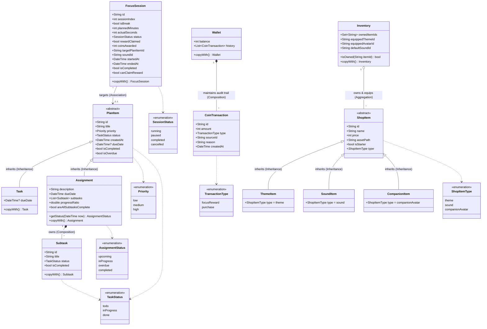

# 03 Domain Model

The domain model is the set of entities the app works with. The course asks for **at least 4 meaningful entities with meaningful relationships**. TaskStella models 8 core domain entities for Milestone 2 covering all four user stories (US-01 through US-04).

## Priority of Entities

| Priority | Entities | Why |
|---|---|---|
| **Core (Milestone 2)** | PlanItem (Abstract), Task, Assignment, Subtask, FocusSession, Wallet, CoinTransaction, ShopItem (Abstract: ThemeItem, SoundItem, CompanionItem), Inventory | Cover all four core user stories (US-01 to US-04) with comprehensive OOP modeling (Inheritance, Composition, Aggregation, Association) |
| **Later / Future Scope (Milestone 3)** | Course, Note, ScheduleBlock, UserProfile | Optional future enhancements per `README.md` |

## Relationships & UML Class Diagram

### Relationship Breakdown

| Relationship | Type | Multiplicity | Description |
|---|---|---|---|
| **`PlanItem` <\|-- `Task`, `Assignment`** | **Inheritance (`<\|--`)** | `1` to `*` | `PlanItem` is an abstract base providing unified scheduling attributes (`id`, `title`, `priority`, `status`, `createdAt`, `dueDate`, `isCompleted`, `isOverdue`). Subclasses specialize optional vs. mandatory deadlines and subtask decomposition. |
| **`ShopItem` <\|-- `ThemeItem`, `SoundItem`, `CompanionItem`** | **Inheritance (`<\|--`)** | `1` to `*` | `ShopItem` is an abstract base providing common store catalog properties (`id`, `name`, `price`, `assetPath`, `isStarter`). Subclasses specialize each catalog category type. |
| **`Assignment` → `Subtask`** | **Composition (`*--`)** | `1` to `*` | An `Assignment` directly owns its `subtasks`. Deleting an assignment cascade-deletes its subtasks. |
| **`Wallet` → `CoinTransaction`** | **Composition (`*--`)** | `1` to `*` | The wallet directly encapsulates its immutable audit history (`List<CoinTransaction>`). Balance mutations append permanent audit records. |
| **`Inventory` → `ShopItem`** | **Aggregation (`o--`)** | `1` to `*` | Inventory holds references to unlocked catalog item IDs (`Set<String> ownedItemIds`). Items exist independently in the static shop catalog. |
| **`FocusSession` → `PlanItem`** | **Association (`-->`)** | `*` to `0..1` | A timer session polymorphically targets any `PlanItem` (`Task` or `Assignment`) via `targetPlanItemId` for focus tracking. Targets exist independently. |
| **`FocusSession` → `Task` / `Assignment`** | **Association (`-->`)** | `*` to `0..1` | A timer session optionally targets a specific task or assignment ID for focus tracking. Targets exist independently. |

## Core Entities (Milestone 2)

All model classes are immutable (`final` fields) with `copyWith` methods and input assertion guards. Abstract classes define core contracts and shared business logic.

### PlanItem (Abstract Base - US-01 & US-02)

Abstract parent representing any schedulable academic or personal item in TaskStella. Eliminates code duplication, enables polymorphic agenda views (e.g. `List<PlanItem>` for today's agenda on Home screen), and allows `FocusSession` to target either a `Task` or an `Assignment` via a single reference.

| Field | Type | Rule |
|---|---|---|
| `id` | String | Unique |
| `title` | String | Not empty, not whitespace only |
| `priority` | Priority (`low`, `medium`, `high`) | Required, default `medium` |
| `status` | TaskStatus (`todo`, `inProgress`, `done`) | Lifecycle status, default `todo` |
| `createdAt` | DateTime | Creation timestamp |
| `dueDate` (getter) | DateTime? | Abstract getter. Optional on `Task`, mandatory on `Assignment` |

**Shared Domain Helpers on `PlanItem`:**
- `bool get isCompleted => status == TaskStatus.done`
- `bool get isOverdue => dueDate != null && !isCompleted && DateTime.now().isAfter(dueDate!)`

---

### Task (US-01) — Extends `PlanItem`

Standalone daily task/to-do item.

| Field | Type | Rule |
|---|---|---|
| *(inherited)* `id`, `title`, `priority`, `status`, `createdAt` | Inherited from `PlanItem` | See `PlanItem` rules |
| `dueDate` | DateTime, optional | Overrides abstract getter as an optional calendar deadline |

---

### Assignment (US-02) — Extends `PlanItem`

Major academic coursework with subtasks and a strict deadline.

| Field | Type | Rule |
|---|---|---|
| *(inherited)* `id`, `title`, `priority`, `status`, `createdAt` | Inherited from `PlanItem` | See `PlanItem` rules |
| `dueDate` | DateTime | Required submission deadline (overrides abstract getter as non-nullable) |
| `description` | String, optional | Free-form coursework details |
| `subtasks` | List of Subtask | Preserved on assignment edit; cascade-deleted on assignment delete |

**Derived Status** (`getStatus(DateTime now)`):

| Status | Condition |
|---|---|
| `completed` | `status == TaskStatus.done` |
| `overdue` | not completed and `now.isAfter(dueDate)` |
| `inProgress` | `status == TaskStatus.inProgress` or `progressRatio > 0` |
| `upcoming` | not completed and `dueDate` is now or in the future |

**Assignment Helpers:**
- `double get progressRatio`: Returns ratio of completed subtasks (`0.0` if subtasks empty)
- `bool get areAllSubtasksComplete`: `subtasks.isNotEmpty && subtasks.every((s) => s.isCompleted)`

---

### Subtask (US-02)

| Field | Type | Rule |
|---|---|---|
| `id` | String | Unique |
| `title` | String | Not empty, not whitespace only |
| `status` | TaskStatus | Lifecycle status (`todo`, `inProgress`, `done`), default `todo` |

---

### FocusSession (US-03)

| Field | Type | Rule |
|---|---|---|
| `id` | String | Unique |
| `sessionIndex` | int | Cycle index (e.g., 1 to 4 in a 4-session focus cycle) |
| `isBreak` | bool | Default `false`. `true` for 5-minute break session, `false` for 25-minute focus session |
| `plannedMinutes` | int | Greater than 0 (default: 25 for focus, 5 for break) |
| `actualSeconds` | int | Time actually focused, pauses excluded |
| `status` | SessionStatus (`running`, `paused`, `completed`, `cancelled`) | See state diagram in [04-services-and-rules.md](04-services-and-rules.md#3-focusservice) |
| `rewardClaimed` | bool | Default `false`. Set to `true` when user claims coin reward upon completion; prevents duplicate claims. Break sessions cannot claim rewards |
| `targetPlanItemId` | String, optional | Polymorphic reference to any target `PlanItem` (`Task` or `Assignment`) the student focused on |
| `soundId` | String, optional | Must reference an owned sound |
| `startedAt` | DateTime | Timestamp when session started |
| `endedAt` | DateTime, optional | Timestamp when session completed or cancelled |
| `coinsAwarded` | int | 0 until reward claimed |

---

### Wallet and CoinTransaction (US-04)

| Wallet Field | Type | Rule |
|---|---|---|
| `balance` | int | Mathematically guaranteed ≥ 0 |
| `history` | List of CoinTransaction | Immutable transaction audit trail |

| CoinTransaction Field | Type | Rule |
|---|---|---|
| `id` | String | Unique |
| `amount` | int | Positive for earning, negative for spending |
| `type` | TransactionType (`focusReward`, `purchase`) | Category of transaction |
| `sourceId` | String | ID of session or shop item |
| `reason` | String | Human-readable audit description |
| `createdAt` | DateTime | Timestamp of transaction |

---

### ShopItem (Abstract Base - US-04) & Subclasses

Abstract base for all items available in the reward shop. Subclasses cleanly specialize each item type:
- **`ThemeItem extends ShopItem`**: Visual background themes (`type = ShopItemType.theme`)
- **`SoundItem extends ShopItem`**: Ambient audio soundscapes (`type = ShopItemType.sound`)
- **`CompanionItem extends ShopItem`**: Companion mascot avatar customizations (`type = ShopItemType.companionAvatar`)

| Field | Type | Rule |
|---|---|---|
| `id` | String | Unique catalog item ID |
| `name` | String | Not empty |
| `type` (getter) | ShopItemType (`theme`, `sound`, `companionAvatar`) | Abstract getter overridden by concrete subclass |
| `price` | int | ≥ 0 |
| `assetPath` | String | Bundled asset path |
| `isStarter` | bool | Starter items are free and always owned |

---

### Inventory (US-04)

| Field | Type | Rule |
|---|---|---|
| `ownedItemIds` | Set of String | IDs of unlocked items; includes starter items |
| `equippedThemeId` | String | ID of currently active theme |
| `equippedAvatarId` | String | ID of currently active companion avatar |
| `defaultSoundId` | String | ID of currently active background sound |

---

## Later / Future Scope (Milestone 3 per README.md)

- **Course:** `id`, `name`, `colorKey`, `createdAt`. Groups tasks and assignments once the core planner is delivered.
- **Note:** `id`, `title`, `body`, optional link to assignment, `updatedAt`.
- **ScheduleBlock:** `id`, `title`, `start`, `end`, `repeat`.
- **UserProfile:** `displayName`, `streakCount`, `onboardingCompleted`.
