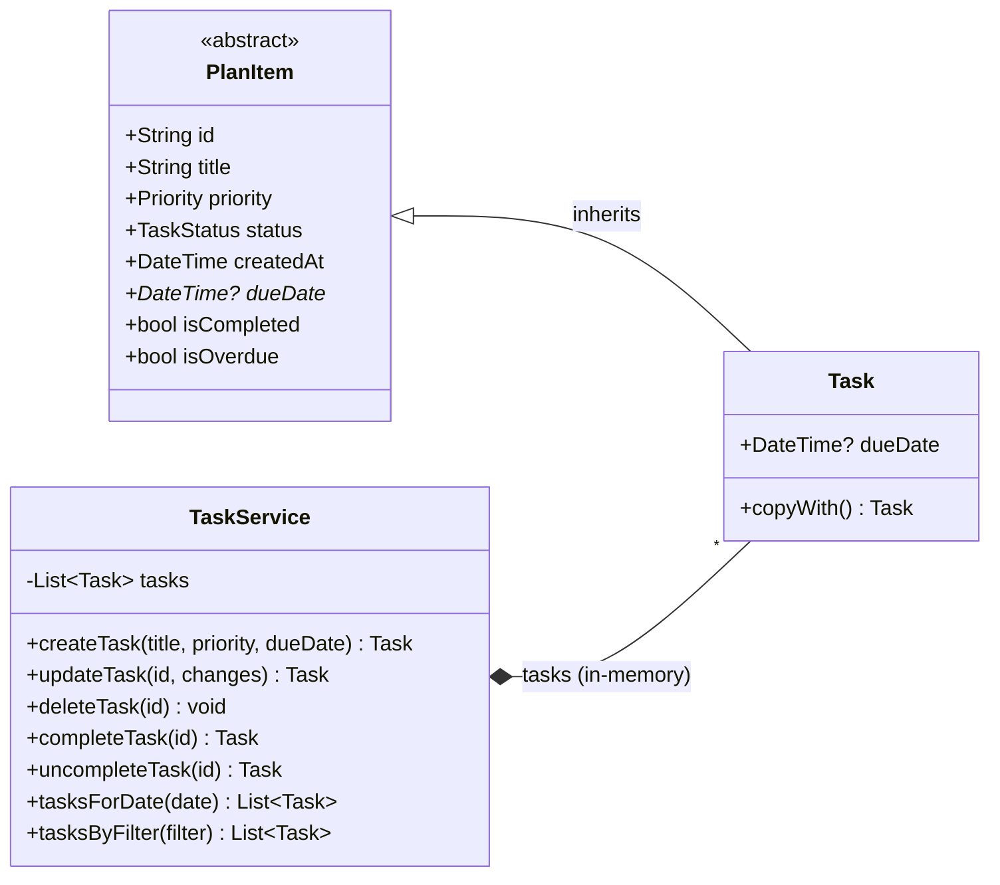
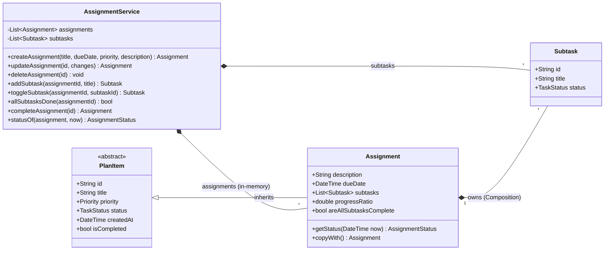
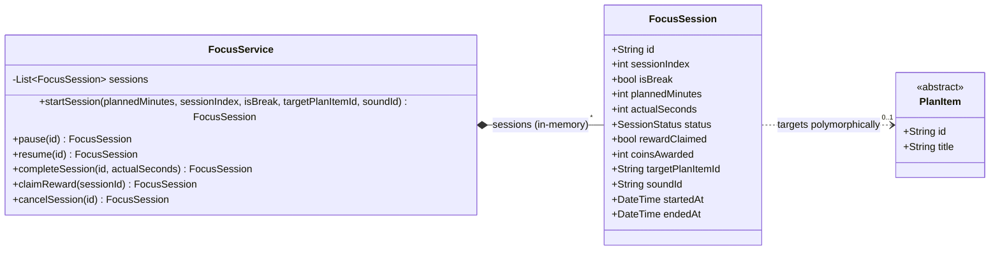
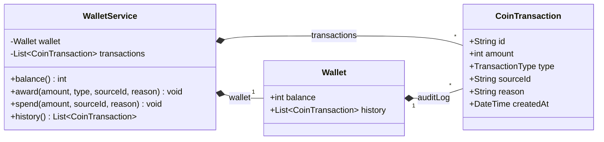
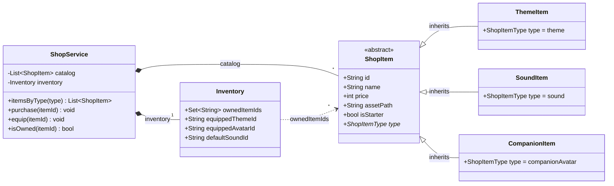
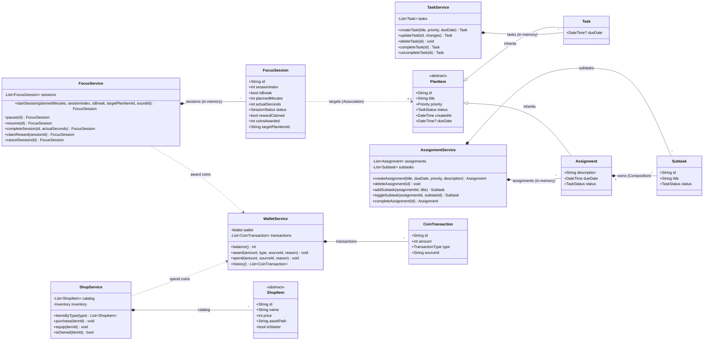
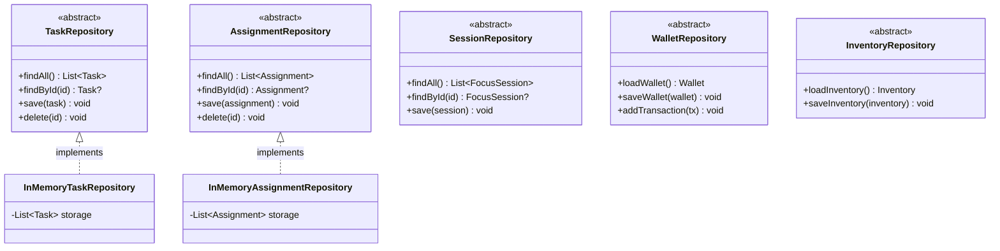

# 04 Services and Business Rules

Services hold the business logic. They are plain Dart classes with no Flutter imports, so every operation can be unit tested. The course asks for **at least 2 services**, **rules beyond CRUD**, and **at least 1 operation involving several entities**. TaskStella has five services for Milestone 2. The operations marked **multi-entity** are the ones to highlight in presentations.

Every operation below lists its rules and its invalid cases. Each row maps directly to tests (see [05-testing.md](05-testing.md)).

## Overview

| Service | Owns | Data Storage (Milestone 2) | Depends on | Author |
|---|---|---|---|---|
| **TaskService** | Tasks | Direct in-memory `List<Task>` *(Repository optional)* | None | Tiek Chhunhour |
| **AssignmentService** | Assignments, Subtasks | Direct in-memory `List<Assignment>` *(Repository optional)* | None | Tiek Chhunhour |
| **FocusService** | Focus sessions | Direct in-memory `List<FocusSession>` *(Repository optional)* | WalletService, Inventory | Yeat David |
| **WalletService** | Balance and coin history | Direct in-memory `Wallet` + `List<CoinTransaction>` | None | Yeat David |
| **ShopService** | Purchases and equipping | In-memory catalog + user `Inventory` | WalletService | Yeat David |

*WalletService is the only class allowed to change the coin balance. Other services invoke its methods to award or spend coins.*

> [!NOTE]
> **Data Storage in Repositories is Optional Right Now:**  
> For Milestone 2, storing data through dedicated `Repository` classes is **completely optional**. Services manage their own state directly in in-memory collections (e.g. `List<Task> _tasks` inside `TaskService`). This keeps Milestone 2 lightweight, simple, and 100% unit-testable. The abstract repository layer (`TaskRepository`, etc.) is an optional architecture pattern that can be adopted later in Milestone 4 when connecting to permanent device storage (SQLite or `shared_preferences`).

---

## Service Architecture Diagrams

### 1. `TaskService` Diagram
*Manages task lifecycle and status transitions (`todo` ↔ `done`). `Task` inherits common scheduling properties from `PlanItem`. Tasks do not award coins:*



---

### 2. `AssignmentService` Diagram
*Manages assignment lifecycle, subtask decomposition, cascade deletion, and independent subtask completion. `Assignment` inherits from `PlanItem`. Assignments do not award coins:*



---

### 3. `FocusService` Diagram
*Manages focus timer states and session reward claiming across 25-minute study intervals and 5-minute break intervals. Associates polymorphically with any `PlanItem` (`Task` or `Assignment`):*



---

### 4. `WalletService` Diagram
*Sole authority for coin transactions, guaranteeing non-negative balance and an append-only audit trail:*



---

### 5. `ShopService` Diagram
*Controls reward store purchases, inventory, and equipped customizations. `ShopItem` is an abstract base specialized by category subclasses:*



---

### 6. Full TaskStella Service Layer Architecture
*Shows all 5 services, the domain entities & abstract hierarchies they own, entity cross-references, and coordination with `WalletService`:*



---

### 7. Optional Repository Contracts (Future / M4 Storage Abstraction)
*Storing data in dedicated `Repository` classes is **completely optional** for Milestone 2. To keep Milestone 2 simple and testable, services can hold their in-memory data collections directly. When permanent storage is introduced in Milestone 4 (such as SQLite or `shared_preferences`), abstract repository contracts can be implemented to decouple storage from business logic:*



---

## Coin Rules

| Activity | Coins | Notes |
|---|---|---|
| Complete a focus session (25 min) | 25 (1 per focus minute) | Claimed per session once completed (`rewardClaimed` lock). Standard 4-session focus cycle with 25m work intervals. |
| Break session (5 min) | 0 | 5-minute rest interval following a focus session; does not earn coins. |
| Finish a focus session early | 1 per 2 full minutes focused, rounded down | e.g., 20 of 25 min = 10 coins; 9 min focused = 4 coins. Under 5 min focused (300s) = 0 coins. Claimed once per session. |
| Cancel a focus session | 0 | Incomplete session awards zero coins; reward cannot be claimed. |
| Complete a task | 0 | Tasks do not award coins; task completion is strictly for planner scheduling (no checkbox farming). |
| Complete an assignment / subtask | 0 | Assignments and subtasks do not award coins (prevents checkbox farming). |

### Early Finish Calculation Examples
Formula: `actualSeconds ~/ 120` (or `minutesFocused ~/ 2`), with a 5-minute (300s) anti-farming threshold.

| Focus Time | Calculation | Coins Awarded | Notes |
|---|---|---|---|
| **4m 30s** | Under 5 minutes | **0 coins** | **Anti-farming threshold:** sessions under 5 minutes (< 300s) award nothing. |
| **5 minutes** | `5 ~/ 2 = 2.5` → | **2 coins** | 4 minutes counted (2 × 2 min), 1 minute leftover dropped. |
| **9 minutes** | `9 ~/ 2 = 4.5` → | **4 coins** | 8 minutes counted (4 × 2 min), 1 minute leftover dropped. |
| **10 minutes** | `10 ~/ 2 = 5.0` → | **5 coins** | Exactly five 2-minute blocks. |
| **20 minutes** | `20 ~/ 2 = 10.0` → | **10 coins** | Exactly ten 2-minute blocks. |
| **25 minutes (Full)** | Full completion | **25 coins** | Completed the planned goal; full rate (1 coin per planned minute) applies. |

---

## Service Operations & Business Logic

### 1. TaskService (Author: Tiek Chhunhour)

| Operation | Rules | Invalid Cases |
|---|---|---|
| `createTask(title, priority, dueDate?)` | Trims the title. Saves a new task with `status: TaskStatus.todo`. | Empty or whitespace title. |
| `updateTask(id, changes)` | Same title rules. Preserves status and created timestamp. | Unknown ID. Empty title. |
| `deleteTask(id)` | Removes the task from storage. | Unknown ID. |
| `completeTask(id)` | Sets status to `done`. Does not award coins (tasks do not claim rewards). | Unknown ID. |
| `uncompleteTask(id)` | Sets status back to `todo`. | Unknown ID. |
| `tasksForDate(date)` | Filters tasks due on given calendar date. | None. |
| `tasksByFilter(filter)` | Filters by priority or status. | None. |

---

### 2. AssignmentService (Author: Tiek Chhunhour)

| Operation | Rules | Invalid Cases |
|---|---|---|
| `createAssignment(title, dueDate, priority, {description})` | Saves an assignment with `status: TaskStatus.todo`. | Empty or whitespace title. |
| `updateAssignment(id, changes)` | Preserves every existing subtask and its completed state. | Unknown ID. Empty title. |
| `deleteAssignment(id)` **composition cascade** | Removes the assignment and all of its child subtasks simultaneously. | Unknown ID. |
| `addSubtask(assignmentId, title)` | Appends a new subtask (`status: TaskStatus.todo`) to the assignment. | Empty title. Unknown assignment ID. |
| `toggleSubtask(assignmentId, subtaskId)` | Flips subtask status between `todo` and `done`. Does not award coins (subtasks do not claim rewards). Completing all subtasks does **not** auto-complete the assignment. | Unknown assignment or subtask ID. |
| `allSubtasksDone(assignmentId)` | Returns true if there is at least one subtask and all are `done`. False if subtasks list is empty. | Unknown assignment ID. |
| `completeAssignment(id)` | Explicit student submission. Transitions status to `done`. Does not award coins (assignments do not claim rewards). | Unknown ID. |
| `statusOf(assignment, now)` | Returns `upcoming`, `inProgress`, `overdue`, or `completed`. | None. |
| `assignmentsByStatus(status, now)` | Filters assignments by their dynamic status. | None. |

---

### 3. FocusService (Author: Yeat David)

Focus mode is structured into sessions (e.g., 4 focus sessions per cycle, each lasting 25 minutes, followed by a 5-minute break session). Students can claim coin rewards upon completing each 25-minute focus session (`rewardClaimed: bool`), but not on break sessions, and not from tasks or assignments.

Session State Lifecycle:
```text
            start
  (none) ─────────> running ──pause──> paused
                      │  ^              │
                      │  └───resume─────┘
          time ends / │
          finish early│            cancel (from running or paused)
                      v                 v
                  completed         cancelled
                      │
                 claimReward
                      v
             [rewardClaimed: true]
```

| Operation | Rules | Invalid Cases |
|---|---|---|
| `startSession(plannedMinutes, {sessionIndex = 1, isBreak = false, targetPlanItemId?, soundId?})` | Creates a running session. Standard focus session is 25 minutes; break session is 5 minutes. Validates sound is owned if soundId provided. Rejects if another session is already running. | Planned minutes ≤ 0. Sound not owned. Another session currently running. |
| `pause(id)` | Transitions from `running` to `paused`. Paused time does not count toward focus duration. | Not in `running` state. |
| `resume(id)` | Transitions from `paused` to `running`. | Not in `paused` state. |
| `completeSession(id, actualSeconds)` | Transitions to `completed`. Records duration. Sets session eligible for reward claim (`rewardClaimed: false`). Break sessions complete without reward eligibility. | Session already ended. Actual seconds ≤ 0. |
| `claimReward(sessionId)` **multi-entity** | Verifies session is `completed`, is a focus session (`!isBreak`), and `rewardClaimed == false`. Awards 25 coins for full 25-minute session (1 coin/min). Awards 1 coin per 2 full minutes if finished early (≥ 300s). Awards 0 if < 300s. Calls `WalletService.award(...)` and locks `rewardClaimed = true`. | Session not found. Session not completed. Break session (`isBreak == true`). Reward already claimed (`rewardClaimed == true`). |
| `cancelSession(id)` | Transitions to `cancelled`. Awards 0 coins; reward cannot be claimed. | Session already ended. |

---

### 4. WalletService (Author: Yeat David)

| Operation | Rules | Invalid Cases |
|---|---|---|
| `balance` (getter) | Returns verified current coin balance. Guaranteed ≥ 0. | None. |
| `award(amount, type, sourceId, reason)` **multi-entity** | Adds coins and records immutable `CoinTransaction`. Rejects duplicate reward for the same `type` and `sourceId`. | Amount ≤ 0. Duplicate source reward. |
| `spend(amount, sourceId, reason)` **multi-entity** | Deducts coins and records negative `CoinTransaction`. Verifies sufficient balance prior to deduction. | Amount ≤ 0. Amount > current balance: rejected, balance unchanged. |
| `history()` | Returns transactions in reverse chronological order (newest first). | None. |

---

### 5. ShopService (Author: Yeat David)

| Operation | Rules | Invalid Cases |
|---|---|---|
| `itemsByType(type)` | Returns catalog items for category, with ownership indicator. | None. |
| `purchase(itemId)` **multi-entity** | Verifies item exists in catalog, checks item is not already owned (`!inventory.isOwned(itemId)`), checks sufficient balance (`balance >= price`). Spends coins via `WalletService.spend(...)` and adds `itemId` to `inventory.ownedItemIds`. Atomic. | Unknown item ID. Item already owned (`StateError`). Insufficient balance (`StateError`): nothing deducted, item not acquired. |
| `equip(itemId)` | Equips an owned item. Updates `equippedThemeId`, `equippedAvatarId`, or `defaultSoundId`. | Item not owned (`ArgumentError`). |
| `isOwned(itemId)` | Checks if item is a starter item (`isStarter == true`) or in `inventory.ownedItemIds`. | None. |

---

## Rules Summary & Validation Guardrails

| Rule | Where Enforced |
|---|---|
| Blank or whitespace titles rejected | `TaskService.createTask`, `AssignmentService.createAssignment`, `Subtask` constructor |
| Tasks and assignments do not award coins | Tasks and assignments track planner status only; `rewardClaimed` is not allowed on tasks/assignments (prevents checkbox farming) |
| A completed focus session can only be claimed once | `rewardClaimed` flag on `FocusSession` plus `WalletService` duplicate check |
| Break sessions do not earn coins | 5-minute break sessions between focus blocks award 0 coins |
| Completing all subtasks does not auto-complete assignment | `AssignmentService.toggleSubtask` leaves assignment open for review |
| Editing an assignment preserves existing subtasks | `AssignmentService.updateAssignment` preserves subtask list |
| Deleting an assignment cascade-deletes all subtasks | `AssignmentService.deleteAssignment` (Composition rule) |
| Focus duration must be positive | `FocusService.startSession`, `FocusSession` constructor assert |
| Cancelled or < 5 min sessions get 0 coins | `FocusService.cancelSession`, `claimReward` threshold check |
| Not enough coins: rejected with zero state change | `WalletService.spend`, `ShopService.purchase` |
| Balance can never be negative | `WalletService.spend` balance check + `Wallet` assertion `balance >= 0` |
| Owned items cannot be bought twice | `ShopService.purchase` checks `!inventory.isOwned(itemId)` |
| Free starter items always owned | `ShopItem.isStarter`, `Inventory.isOwned` |
